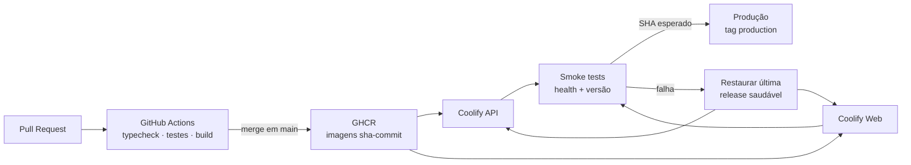

<div align="center">


# Foucusly

### Focus deliberately. Finish consistently.

Um sistema local-first de foco para transformar ciclos Pomodoro em trabalho concluído.

[](https://www.typescriptlang.org/)
[](https://react.dev/)
[](https://fastify.dev/)
[](https://sqlite.org/)

`Pomodoro` · `tarefas` · `projetos` · `relatórios` · `notificações` · `webhooks`

</div>

---

## O que é

Foucusly é um aplicativo de foco baseado na técnica Pomodoro. Ele reúne o ciclo de trabalho em um único fluxo: escolha uma tarefa, inicie uma sessão de foco, faça pausas intencionais e acompanhe o que realmente foi concluído.

O app foi pensado para funcionar localmente. Seus perfis, tarefas, projetos, configurações, estado do timer e histórico de sessões ficam em uma base SQLite controlada pela sua instalação — sem depender de login ou de um serviço externo para começar.

> **Perfis não são autenticação.** Eles separam dados locais no mesmo app; autenticação de contas faz parte do roadmap.

## Como funciona

```text
Escolha um perfil
      ↓
Crie um projeto e suas tarefas
      ↓
Inicie um Pomodoro em uma tarefa
      ↓
Conclua o ciclo → a sessão é registrada
      ↓
Faça uma pausa curta ou longa
      ↓
Consulte relatórios, sequência e rankings
```

Cada perfil pode configurar a duração do Pomodoro, das pausas curtas e longas, o intervalo da pausa longa, início automático, sons, tema, ordem das tarefas e comportamento de conclusão automática.

Quando uma sessão de foco termina, o Foucusly registra um histórico idempotente, atualiza o progresso da tarefa relacionada e, se configurado, a conclui ou move para o fim da lista. Os relatórios usam essas sessões concluídas como fonte de verdade.

## Recursos atuais

- Ciclos de Pomodoro, pausa curta e pausa longa, com início automático opcional.
- Projetos persistentes, cores, arquivamento/restauração e tarefas com estimativa de Pomodoros.
- Perfis locais para manter dados separados no mesmo dispositivo.
- Timer persistente: recarregar a página não descarta o estado atual.
- Relatórios diários, semanais, mensais e anuais, com detalhes de sessão e rankings por projeto ou tarefa.
- Sons de alarme e ambiente, preferências visuais e modo escuro durante uma sessão.
- Notificações Web Push quando um timer termina e um lembrete opcional minutos antes do fim, em navegadores e ambientes compatíveis.
- Webhooks de saída opcionais para sessão concluída e tarefa concluída, com ping de teste.
- Interface responsiva, incluindo a rota simplificada `/app`.

## Arquitetura

```text
React + Vite (apps/web)
        │  /api + x-profile-id
        ▼
Fastify + Zod (apps/api)
        │
        ▼
SQLite + WAL (data/foucusly.sqlite)
```

O frontend React mantém a experiência ao vivo do timer e se comunica com uma API Fastify. A API valida entradas com Zod, protege os dados por perfil e persiste tudo em SQLite com WAL habilitado. Os contratos TypeScript compartilhados ficam em `packages/contracts`, evitando divergências entre interface e backend.

Para o mapa de componentes, modelo de dados, ciclo do timer, notificações e limites operacionais, veja [architecture.md](architecture.md). Para instruções de contribuição orientadas a agentes, veja [AGENTS.md](AGENTS.md).

## Entrega contínua



Cada release usa imagens imutáveis identificadas pelo SHA do commit. O deploy só é considerado concluído quando API e web servem a versão esperada; uma falha restaura a última release saudável, sem alterar os dados persistentes em SQLite.

Para empacotamento, CI/CD, deploy no Coolify e recuperação de releases, veja o [guia de CI/CD](docs/ci-cd.md).

## Comece em minutos

**Pré-requisito:** [Bun](https://bun.com) 1.3+ para dependências e scripts, e Node.js 22+ como runtime da API.

```sh
git clone <seu-repositorio>
cd pomofocus
bun install
bun run dev
```

Abra [http://localhost:5173](http://localhost:5173) para a experiência completa ou [http://localhost:5173/app](http://localhost:5173/app) para a página do timer. A API inicia em `http://localhost:3001`.

O banco de dados é criado em `data/foucusly.sqlite` por padrão. Para usar outro caminho:

```sh
DATABASE_PATH=/caminho/para/foucusly.sqlite bun run dev:api
```

## Comandos

| Comando | Descrição |
| --- | --- |
| `bun run dev` | Inicia API e frontend em modo de desenvolvimento. |
| `bun run dev:api` | Inicia somente a API Fastify com recarregamento. |
| `bun run dev:web` | Inicia somente o Vite. |
| `bun run typecheck` | Verifica os tipos de todos os workspaces. |
| `bun run build` | Compila contratos, API e frontend. |
| `bun run start` | Inicia a API compilada. |

## Produção

1. Execute `bun run build`.
2. Inicie a API com `bun run start`.
3. Sirva `apps/web/dist` em um servidor estático.
4. Configure esse servidor para encaminhar `/api` à API Fastify.
5. Faça backup de `data/foucusly.sqlite`: ele é a fonte de verdade dos dados da instalação.

As variáveis de ambiente mais relevantes são `PORT`, `HOST`, `DATABASE_PATH`, `CORS_ORIGINS`, `TRUST_PROXY` e `PUSH_POLL_INTERVAL_MS`. As chaves VAPID para Web Push podem ser configuradas ou persistidas localmente pela API.

## Webhooks

Webhooks de saída fazem parte do app, sem paywall. Em **Settings → Integration**, cole uma URL, ative o envio, escolha os eventos e salve com **OK**. Uma URL vazia deixa o recurso desligado.

O Foucusly faz `POST` de um JSON versão 1, com timeout de 4 segundos e uma nova tentativa se a resposta for 5xx ou se o tempo estourar. Falha de entrega não desfaz a sessão nem a tarefa. O último erro fica em `webhookLastError` nas configurações do perfil. O `session_id` permite ao receptor ignorar uma segunda tentativa do mesmo evento.

HTTPS é obrigatório. `http://localhost` e `http://127.0.0.1` (e o bloco de loopback) valem só para teste local. Endereços privados, link-local e respostas DNS que apontem para eles são recusados. Redirecionamentos não são seguidos.

Se o segredo estiver preenchido, cada requisição inclui `X-Foucusly-Signature: sha256=<hex>`, o HMAC-SHA256 do corpo bruto em UTF-8. Sem segredo, o cabeçalho não vai. Não há header `Authorization: Bearer`.

Eventos ao vivo: `session.finished` (somente insert novo em `POST /api/sessions`; repetir o mesmo id não dispara) e `task.completed` (quando a tarefa passa a concluída, no check automático ou no patch manual). O botão **Test** envia `ping` e mostra o resultado, mesmo antes de ativar os eventos.

Corpo: `{ event, timestamp, profileId, data }`. `session.finished` traz (estilo Pomofocus) `type` (`focus`/`short-break`/`long-break`), `round`, `task`, `project`, `session_start`, `session_end`, `seconds`, além de `session_id`, `task_id` e `project_id`. Com token configurado é enviado `Authorization: Bearer <token>`. `task.completed` traz `task_id`, `task_title`, `project_id`, `project_name`, `estimated_pomos` e `completed_pomos`.

### Zapier Catch Hook

1. No Zapier, crie um Zap com **Webhooks by Zapier → Catch Hook** e copie a URL.
2. No Foucusly, cole a URL em **Webhook URL**, marque **Session finished** e/ou **Task completed**, ligue **Enabled** e clique em **OK**.
3. Clique em **Test**. No Zapier, use **Test trigger** para ver o `ping`.
4. Mapeie `event`, `data.task`, `data.seconds` e `data.project` nos passos seguintes.

O Catch Hook não valida o HMAC. Deixe o segredo vazio, a menos que o destino saiba conferir `X-Foucusly-Signature`.

## Roadmap

O Foucusly já é útil como aplicação local. As próximas evoluções devem preservar essa simplicidade enquanto abrem portas para fluxos conectados:

- [ ] **Autenticação e contas** — login seguro, sessões e separação entre identidade e perfis locais.
- [ ] **Sincronização entre dispositivos** — manter timer, tarefas e histórico consistentes em mais de um dispositivo.
- [x] **Webhooks de saída** — `session.finished` e `task.completed` para uma URL do perfil, com ping de teste. Sessão iniciada, pausa, fila de entregas e vários destinos ficam para depois.
- [ ] **Integrações** — conectar projetos e tarefas a ferramentas como calendário, Notion, Todoist ou Slack.
- [ ] **Exportação e backup guiado** — exportar sessões, relatórios e dados do usuário de forma simples.
- [ ] **PWA/offline aprimorado** — instalação no dispositivo e uma experiência resiliente sem conexão.
- [ ] **Relatórios avançados** — metas, tendências, comparações de períodos e insights de hábitos.

## Princípios

> **Foco sem atrito. Dados sob seu controle. Métricas que representam trabalho real.**

Foucusly não tenta ser uma plataforma de produtividade inchada. A ideia é manter o ciclo essencial — decidir, focar, pausar e aprender com o histórico — rápido e confiável.
